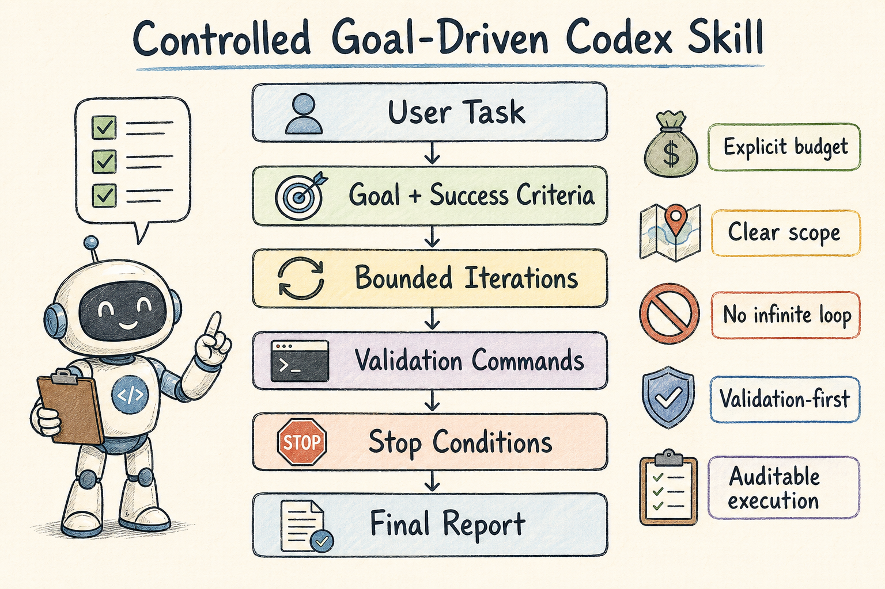

<div align="center">

# Controlled Goal-Driven Codex Skill

**A practical, bounded, validation-first Codex skill for complex engineering tasks.**

Current version: **1.4.0**. See the [changelog](./CHANGELOG.md).

[Chinese README](./README.zh-CN.md) · [Original Inspiration](https://github.com/lidangzzz/goal-driven)

</div>

---

## 🌟 Overview



This repository packages a controlled goal-driven workflow as a small Codex skill project. It is meant for tasks where progress can be validated, iteration is useful, and stopping conditions matter.

## 🤔 What is this?

This skill converts a broad engineering request into a bounded loop:

1. clarify the goal
2. define success criteria
3. stay inside the allowed editing scope
4. run validation commands
5. iterate only while progress is measurable
6. stop with a concise final report

Core idea:

> Do not just try harder. Work toward a clear goal, validate results, and stop when further attempts are not justified.

v1.1 distinguishes **check results** (PASS / FAIL / BLOCKED / NOT_RUN), **iteration progress** (PROGRESS / NO_PROGRESS / REGRESSION / UNKNOWN), and **terminal states** (SUCCESS / NO_PROGRESS / REGRESSION / BLOCKED / BUDGET_EXHAUSTED / NEEDS_DECISION). Repeating one error does not automatically terminate work when comparable evidence shows progress.

## 🛠️ Installation

From a source checkout, run these commands at the repository root. The destination must not already exist; use the update procedure below for an existing installation.

Windows PowerShell:

```powershell
$skillDir = Join-Path $env:USERPROFILE '.agents\skills\controlled-goal-driven'
if (Test-Path -LiteralPath $skillDir) { throw 'Existing installation: back up and review local changes before updating.' }
New-Item -ItemType Directory -Force -Path (Split-Path -Parent $skillDir) | Out-Null
Copy-Item -LiteralPath .\skill -Destination $skillDir -Recurse
python "$skillDir\scripts\check_install.py" --expected-version 1.4.0
```

macOS / Linux (Bash):

```bash
skill_dir="$HOME/.agents/skills/controlled-goal-driven"
if [ -e "$skill_dir" ] || [ -L "$skill_dir" ]; then
  printf '%s\n' 'Existing installation: back up and review local changes before updating.' >&2
else
  mkdir -p "$HOME/.agents/skills" && cp -R skill "$skill_dir" &&
    python3 "$skill_dir/scripts/check_install.py" --expected-version 1.4.0
fi
```

Alternatively, download the install ZIP from the [release page](https://github.com/Qrzzzz/goal-driven-codex-skill/releases/latest), verify it against its `.sha256` asset, and extract its `controlled-goal-driven/` folder into your skills directory. Do not add an extra nesting level or overwrite an existing installation. The final structure is:

```text
~/.agents/skills/controlled-goal-driven/SKILL.md
~/.agents/skills/controlled-goal-driven/VERSION
~/.agents/skills/controlled-goal-driven/agents/openai.yaml
~/.agents/skills/controlled-goal-driven/references/
~/.agents/skills/controlled-goal-driven/scripts/check_scope.py
~/.agents/skills/controlled-goal-driven/scripts/check_install.py
```

Implicit invocation is disabled by design. Invoke the skill explicitly:

```text
$controlled-goal-driven
```

The smoke checker uses Python 3.11+ and no third-party packages or paid services. Run it from **any directory**; it checks its own installation by default, verifies the version, declared Skill name, shipped explicit-only metadata and transitive local references. It reads files without changing them and exits nonzero for an incomplete or stale installation. It is not a general YAML validator or proof of Codex discovery. If Python is unavailable, manually inspect `VERSION`, `SKILL.md` and `policy.allow_implicit_invocation: false` in `agents/openai.yaml` before explicitly invoking the Skill in Codex.

If Codex cannot find the Skill, check that `SKILL.md` is directly inside `controlled-goal-driven/`, use the skills directory configured for your Codex installation, and start a new chat after installing. An invocation with a small bounded task is the final discovery check; the offline script cannot establish it.

### Update, rollback and uninstall

Before updating, read the installed `VERSION` and compare the **entire installed folder** with the source/release you intend to use. Local customizations must be reviewed and retained deliberately; copying a new release on top can destroy them or leave obsolete files.

1. Download or check out the intended release. Verify it in a separate folder with `check_install.py --expected-version 1.4.0` (substitute the intended version for future releases).
2. Move the current installation to a **new, nonexistent backup location outside the skills directory**; preserve every file. Keep only one installed copy with this Skill name. A backup inside the scanned skills directory can be discovered as a duplicate.
3. Install into the now-empty target using the commands above. Port reviewed customizations deliberately, then re-run the checker and explicitly invoke a small task in Codex. Do not remove the backup until satisfied.
4. To roll back, move the new installation aside to another backup outside the skills directory, then restore the original folder to the original path and verify its original version. Do not merge folders or reset unrelated files.

To uninstall reversibly, move only the `controlled-goal-driven/` folder outside the skills directory and start a new chat. Delete that exact backup later if no longer needed. Checkpoints at separately approved private paths are independent; review and remove them separately if desired.

Maintainers: use the [release verification checklist](./docs/releasing.md) before tagging or publishing.

## 🚀 Usage

```text
$controlled-goal-driven

Goal:
Fix the parser's nested-expression bug.

Success criteria:
- parser tests pass, including a regression test
- no unrelated behavior or files change

Validation:
- npm test -- parser

Scope:
- src/parser/**, tests/parser/**

Budget:
- maximum 3 edit-and-validate iterations

Stop conditions:
- stop after two comparable iterations without progress
- stop if verification is blocked or scope must expand
```

## 🔎 v1.2 Verification and Scope Guard

The core Skill uses short instructions with [on-demand references](./skill/references/). v1.2 adds a **baseline-aware, optional Git scope checker**; a missing checker never overrides an explicit scope limit.

Before editing a Git repository:

```bash
python skill/scripts/check_scope.py snapshot
```

After an edit, check all agent-introduced paths:

```bash
python skill/scripts/check_scope.py check --allow 'src/parser/**' --allow 'tests/parser/**'
```

The checker treats unchanged user-owned dirty files as pre-existing, recognizes staged, unstaged, untracked, deleted and renamed paths, and does not revert files. The tool is advisory, not a sandbox. See [scope checker reference](./skill/references/scope-check.md) and [baseline/regression guidance](./skill/references/baseline-and-validation.md).

Run offline deterministic checks (no API key):

```bash
python -m unittest discover -s tests -v
```

Codex behavior is **not** automatically evaluated by these tests. The [behavioral evaluation guide](./docs/evaluation.md) describes manual/opt-in scenarios and how to collect evidence.

## 🧮 v1.3 Budgets and Explicit Resumption

The default remains **3 implementation iterations**, with **zero extra validation retries**. Optionally set task-wide diagnostic retries, active elapsed time, per-command timeouts, or reliably observable usage limits. A retry needs a concrete transient-failure hypothesis; deterministic errors need a repair. Exhaustion reports the dimension, and unavailable token/cost telemetry stays unknown. See [resource budgets](./skill/references/resource-budgets.md).

Checkpoint storage is optional and requires an explicitly approved location. On a later explicit resume, compare the goal, scope, repository, branch, HEAD and dirty fingerprints, then run fresh validation within the remaining budget. Changed contracts need a decision; consumed iterations and retries never reset. The [session-state protocol](./skill/references/session-state.md) and [synthetic JSON example](./skill/references/session-state.example.json) describe manual evidence records, without background execution or credential storage.

Optional input, in addition to the ordinary Goal/Scope/Validation fields:

```text
Budget: 3 iterations; 1 diagnostic retry total; 600 active seconds; 60 seconds per command.
State: explicitly enable checkpoint storage at <approved private path>.
```

## ✅❌ When to use / When not to use

Use this skill when:

- the task has objective success criteria
- executable checks or independently inspectable evidence exist
- the allowed editing scope is clear
- repeated iterations can improve the result

Do not use this skill when:

- the goal is vague
- success is based only on taste or vibes
- there is no trustworthy validation method
- the user only needs a simple one-shot answer

## 💡 Why this version exists

This workflow is inspired by [Li Dang (@lidangzzz)](https://x.com/lidangzzz)'s [goal-driven](https://github.com/lidangzzz/goal-driven) pattern, but this project focuses more on safety, controllability, and auditable execution in Codex.

Compared with open-ended looping prompts, this skill adds:

- explicit iteration budgets
- mandatory validation evidence
- clear stop conditions
- strict scope awareness
- concise final reporting
- conservative defaults when user constraints are missing

## ⏱️ Why not run forever?

Long-running workflows only make sense if success can be validated.

Good examples:

```bash
npm test
pytest
cargo test
make test
go test ./...
```

Bad examples:

```text
Make this project better.
Keep optimizing until it feels good.
```

If the goal is vague, the skill should plan and stop rather than consume tokens indefinitely.

## 🧭 Recommended input format

```text
Goal:
The concrete thing Codex should accomplish.

Success criteria:
How to know the task is complete.

Validation:
Commands Codex should run to verify progress.

Scope:
Files or directories Codex may edit.

Budget:
Maximum number of iterations or attempts.

Stop conditions:
When Codex should stop and report instead of continuing.
```

## 📚 Examples

- [Test-driven bug fix](./examples/test-driven-bugfix.md)
- [Refactor with scope](./examples/refactor-with-scope.md)
- [Generated test validation](./examples/generated-test-validation.md)
- [v1.1 decision traces and expected stop states](./examples/decision-traces.md)
- [v1.2 test and evaluation protocol](./docs/evaluation.md)

## 📝 Final report should include

- Terminal state and reason
- Goal, permitted scope, and changes made
- Baseline vs final evidence and iterations used
- Per-criterion verified / not met / unverified status
- Validation commands and PASS / FAIL / BLOCKED / NOT_RUN results
- Remaining issues and recommended next action

## 🙏 Acknowledgement

Inspired by Li Dang's original goal-driven workflow:

- GitHub: [lidangzzz/goal-driven](https://github.com/lidangzzz/goal-driven)
- X: [@lidangzzz](https://x.com/lidangzzz)

This repository is an independent, controlled adaptation for safer Codex usage.
